<div align="center">
  

  # Whisper-ONNX-Diarization - Offline Local Audio & Video Transcription with Speaker Labels

  ### 🛠️ A Vite + React-based setup that allows users to upload audio or video recordings and retrieve its text content, optionally labelled by speaker. **Note: For simplicity, this setup only accounts for 'English' transcription.**

**Part 2 of <a href='https://github.com/incubated-geek-cc/whisper-onnx'>whisper-onnx</a>. Based on <a href='https://github.com/xenova/whisper-web/tree/experimental-webgpu'>whisper-webgpu</a>; speaker labels based on <a href='https://huggingface.co/spaces/Xenova/whisper-speaker-diarization'>whisper-speaker-diarization</a>.**

<div align="left">

### 👀 Preview

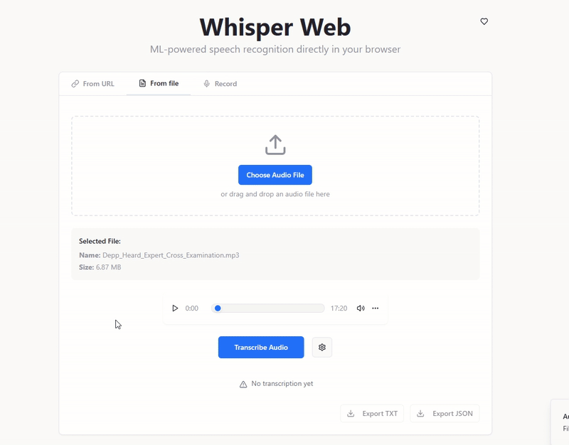

#### Demo (1) Select model choice (non-default)
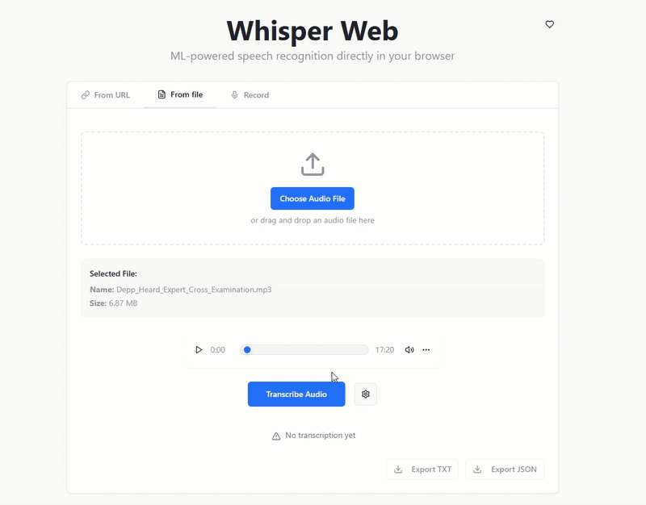

#### Demo (2) Audio Transcription
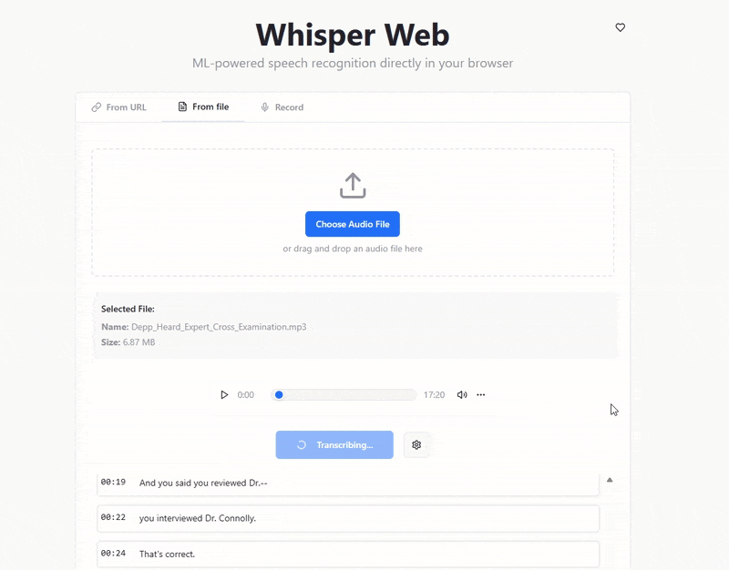

#### Demo (3) Video upload & audio extraction
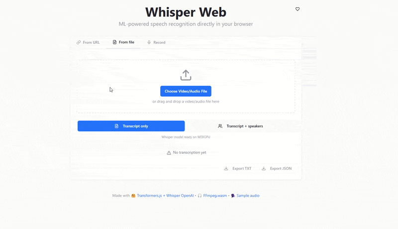

#### Demo (4) Transcript + speakers
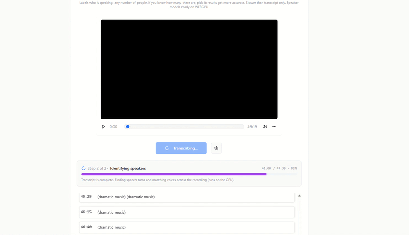

#### Demo (5) Renaming speakers
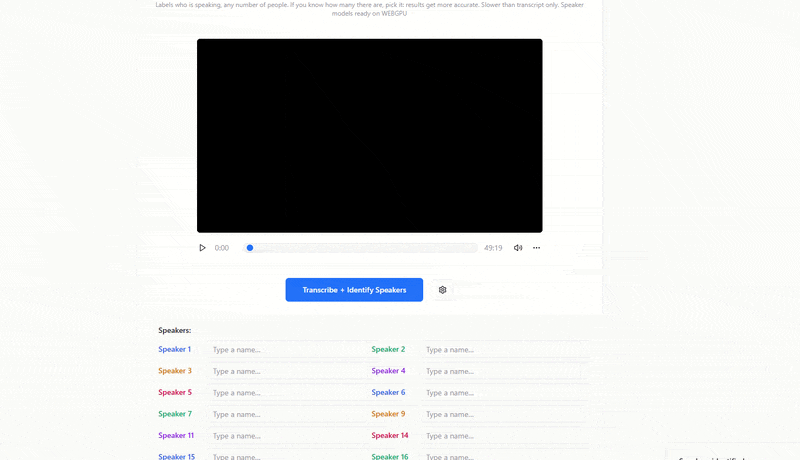

### 🌟 Try it yourself
[**Live Demo :: Link**](https://whisper-onnx-diarization.onrender.com/)

[**Download :: Latest release**](https://github.com/incubated-geek-cc/whisper-onnx-diarization/releases/latest) [](https://github.com/incubated-geek-cc/whisper-onnx-diarization/releases/latest)

### ✍ Read related posts here

<!-- TODO: Part 2 article link -->
[**Part 2 :: Article :: Link :: TODO Part 2 title**](https://geek-cc.medium.com/)

[**Part 1 :: Implementing Whisper OpenAI In-Browser for Offline Audio Transcription**](https://geek-cc.medium.com/adab61be7af7) (code and demo: [whisper-onnx](https://github.com/incubated-geek-cc/whisper-onnx))


## Features

- 📄 Upload audio clips (.mp3 .webm .wav .m4a .ogg .flac files)
- 🎬 Upload video clips (.mp4 .mov .webm .mkv .avi files); the video plays alongside the transcript where the browser supports the format
- 💬 Audio extraction & conversion to 16 kHz WAV via FFMPEG
- 🤖 AI-powered Speech Recognition using Whisper OpenAI local models
- 🗣️ Optional speaker labels ("Transcript + speakers") for any number of speakers, using pyannote + WeSpeaker ResNet34 voiceprints; optionally tell it how many people there are
- ✏️ Rename speakers (e.g. `Speaker 1` → `George`) and every line updates
- 📊 Progress bar through the recording; in speaker mode it shows which step is running
- 💾 Export transcription results (TXT / JSON), including partial results while transcribing
- ⚡ WebGPU acceleration with automatic WASM fallback
- 📱 Mobile-responsive design
- 🔒 Complete offline functionality: models, ONNX Runtime and FFmpeg are all served locally

### What's new compared with Part 1 ([whisper-onnx](https://github.com/incubated-geek-cc/whisper-onnx) v1.0.0)

- **Transcript + speakers** mode, chosen on the main screen next to the Transcribe button.
- **Video uploads** with a video player.
- **Really offline:** whisper-onnx v1.0.0 still downloaded ONNX Runtime from jsDelivr and FFmpeg from unpkg. Both are now served from `public/ort` and `public/ffmpeg`.
- **WebGPU in normal mode:** whisper-onnx v1.0.0's WebGPU setting did not take effect, so it ran on WASM. The device is now chosen properly and shown in the model settings.
- Progress bars, partial export, FFmpeg loaded once and reused, an error message when a file can't be converted.
- `npm run models` checks what is already downloaded and fetches only the missing files.

## Required Model Files

The app runs fully offline, so the models are served from `public/models/`. Only the ONNX files the app loads are needed, plus each model's config and tokenizer files:

| Folder in `public/models/` | Used by | ONNX files |
|---|---|---|
| `Xenova/whisper-tiny.en` | Transcript only (default, fastest) | `encoder_model_fp16.onnx`, `decoder_model_merged_fp16.onnx` |
| `Xenova/whisper-base.en` | Transcript only (more accurate, English) | same as above |
| `Xenova/whisper-base` | Transcript only (multilingual) | same as above |
| `onnx-community/whisper-base_timestamped` | Transcript + speakers (words with timestamps) | `encoder_model.onnx`, `decoder_model_merged_q4.onnx` (WebGPU); `encoder_model_quantized.onnx`, `decoder_model_merged_quantized.onnx` (WASM fallback) |
| `onnx-community/pyannote-segmentation-3.0` | Transcript + speakers (who speaks when) | `model.onnx` |
| `FredrikKarlssonSpeech/pyannote-speaker-diarization-onnx` | Transcript + speakers (voiceprints: matching voices) | `embedding/model.onnx` (WeSpeaker ResNet34, fp32) |

See [`public/models/README.md`](public/models/README.md) for the full folder layout.

> ⚠️ Use `onnx-community/pyannote-segmentation-3.0`, **not** `pyannote/segmentation-3.0`. The original is gated and requires a token.

### Download them with one command

```bash
npm run models
```

[`scripts/download-models.ps1`](scripts/download-models.ps1) first checks `public/models` **without using the network**. If every file is there, it stops. Otherwise it downloads only the missing files from Hugging Face, checks every model file against its published SHA-256, and moves each file into place only once it is complete. Re-run it any time to resume.

**Windows (PowerShell):**
```powershell
powershell -ExecutionPolicy Bypass -File .\scripts\download-models.ps1
```

**macOS / Linux** (needs [PowerShell 7](https://learn.microsoft.com/powershell/scripting/install/installing-powershell)):
```bash
pwsh ./scripts/download-models.ps1
```

Options:
- Check only, download nothing: `-CheckOnly`
- Some models only: `-Models whisper-tiny.en,pyannote-segmentation-3.0`
- Download everything again: `-Force`
- Behind a firewall: set `HF_ENDPOINT` to a Hugging Face mirror before running.

You can also download the files by hand from each model's Hugging Face page (linked in [`public/models/NOTICE.md`](public/models/NOTICE.md)) into the folders above.

> **Cloned the repo?** Large `.onnx` files may be stored with Git LFS. Without `git lfs pull` they are tiny placeholder files and loading fails. `npm run models` treats placeholders as missing and replaces them.

## Hosting the models (live demo on Render)

The model files don't live in git. The live demo's build on Render fetches them with `npm run models:fetch`, from the public Hugging Face repos by default. Render starts every build from a clean copy, so each build downloads all the models again (about 0.7 GB); Hugging Face doesn't meter those downloads. Visitors' browsers still load the models from the site itself, never from Hugging Face.

A **private** Backblaze B2 bucket is optional: a backup copy the build falls back to if a Hugging Face download fails, or the only source with `MODELS_SOURCE=b2`. B2 counts every download against a free allowance of 3× the stored data per billing cycle, so using it for every build runs out after about three deploys. The same list of files (`scripts/models-manifest.json`) is used for downloading, uploading and fetching, so they can't drift apart.

| Command | Runs on | What it does |
|---|---|---|
| `npm run models` | your PC | Hugging Face → `public/models`, only missing files |
| `npm run models:upload` | your PC | `public/models` → bucket, only files the bucket doesn't have (same size = skip) |
| `npm run models:fetch` | Render (or anywhere with Node 20+) | Hugging Face (or the bucket, with `MODELS_SOURCE=b2`) → `public/models`, only missing files; failed Hugging Face downloads are retried from the bucket when the B2 settings are present |

**Optional: setting up the B2 bucket**

1. In Backblaze, keep the bucket **Private** and create application keys limited to that bucket. The master key does not work with the S3 API.
   - For your PC: one key with read **and** write access.
   - For Render: a second key with read-only access.
2. Copy `.env.example` to `.env` and fill in `B2_KEY_ID`, `B2_APPLICATION_KEY`, `B2_BUCKET` and `B2_ENDPOINT` (the bucket's *Endpoint* from the Buckets page, e.g. `https://s3.us-west-004.backblazeb2.com`).
   - `.env` is git-ignored.
   - None of the names start with `VITE_`, so Vite never puts them into the web page.
3. Install the AWS CLI (`winget install --id Amazon.AWSCLI -e`) and open a new PowerShell window. No `aws configure` is needed: the upload script passes the key from `.env` to the CLI for that run only.
4. Preview, then upload. Large files are split into parts automatically.
   ```powershell
   powershell -ExecutionPolicy Bypass -File .\scripts\upload-models.ps1 -DryRun   # shows what would be uploaded
   npm run models:upload
   ```
5. On Render, under *Environment*, add `B2_KEY_ID`, `B2_APPLICATION_KEY` (the read-only key) and `B2_BUCKET`, so the build can fall back to the bucket.

The Render build command is the same either way: `npm install; npm run models:fetch && npm run build`.

## Installation

1. Download the [latest release](https://github.com/incubated-geek-cc/whisper-onnx-diarization/releases/latest) and unzip it, or clone the repository.
2. Install dependencies: `npm install` (Node 20+)
3. Download the models: `npm run models` (or run the script directly, see above)
4. Build: `npm run build`
5. Start: `npm run preview`, then open the address it prints.

Download the models **before** building: `npm run build` copies `public/models` into `dist`, which is what `npm run preview` serves.

## How it works

### Two modes

- **Transcript only** (default): the Whisper model picked in the settings (gear icon) transcribes in 30-second windows and streams timestamped lines.
- **Transcript + speakers**: a separate worker with its own two models.
  1. **Step 1, transcribing audio:** `whisper-base_timestamped` transcribes in 30-second windows (5 s overlap) with a timestamp for every word. Text streams live.
  2. **Step 2, identifying speakers** (`src/workers/speaker-labelling.ts`): `pyannote-segmentation-3.0` hears 10 seconds at a time (the length it was trained on; it tells apart at most 3 voices per window, 2 at once), with windows starting every 5 s. A voice that talks during the shared 5 s of two windows is chained into one *track*: one person's continuous stretch. For each track, WeSpeaker ResNet34 makes a *voiceprint* from up to 10 s of that person speaking alone. Tracks are then grouped (average-linkage clustering on cosine similarity, `src/workers/speaker-clustering.ts`); tracks heard in the same window are never merged. If you pick the number of speakers, grouping stops at exactly that number; otherwise it stops when the closest remaining tracks are less than 0.4 similar. Overlapping speech is labelled with both speakers. `npm run eval` measures accuracy (see [Measuring accuracy](#measuring-accuracy)).
  3. **Merge:** repeated words are collapsed (Whisper sometimes loops on sounds like `[screaming]`), words are grouped into sentences, each sentence goes to the speaker who talks most during it, and consecutive sentences by the same speaker are joined into one line.

Limits of speaker mode: at most 3 people talking within the same minute can be told apart (any number overall); a voice with less than half a second of speech in a minute isn't labelled; people talking over each other are skipped; English only. The 0.8 threshold is a starting point: if one person is split into two labels, or two people merged, pick the number of speakers.

### WebGPU detection & WASM fallback

Both workers use the same check, then fall back to WASM if loading on WebGPU fails:

```js
async function detectDevice() {
  if (!navigator.gpu) return 'wasm';                       // browser has no WebGPU at all
  try {
    return (await navigator.gpu.requestAdapter()) ? 'webgpu' : 'wasm';   // API exists but GPU may be blocklisted
  } catch {
    return 'wasm';
  }
}
```

In Transformers.js v3, the device is chosen with the `device` option of `pipeline(...)`. pyannote always runs on WASM: this model class is not supported on the ONNX Runtime WebGPU backend ([onnxruntime#21386](https://github.com/microsoft/onnxruntime/issues/21386)).

### Quantization & file naming

Transformers.js picks the `.onnx` file by `dtype`:

| dtype | file suffix |
|---|---|
| fp32 | `model.onnx` (no suffix) |
| fp16 | `_fp16.onnx` |
| q8 | `_quantized.onnx` |
| q4 | `_q4.onnx` |

### Fully offline

```js
env.allowLocalModels = true;
env.allowRemoteModels = false;
env.localModelPath = '/models/';
env.backends.onnx.wasm.wasmPaths = '/ort/';   // otherwise Transformers.js fetches ONNX Runtime from jsDelivr
```

FFmpeg is loaded from `public/ffmpeg` with `toBlobURL` instead of its default unpkg URL. After upgrading `@huggingface/transformers` or `@ffmpeg/core`, copy their files into `public/ort` / `public/ffmpeg` again (see the `NOTICE.md` in each folder).

### Video support

The file input accepts `audio/*,video/*`. FFmpeg's `-vn` flag drops the video track:

```js
await ffmpeg.exec(['-y', '-i', inputName, '-vn', '-ar', '16000', '-ac', '1', '-c:a', 'pcm_s16le', 'output.wav']);
```

### Analytics

The live demo on Render counts page views with [GoatCounter](https://www.goatcounter.com/) (no cookies). The tracker is added only when Render builds the site (Render sets `RENDER=true` during builds; see `vite.config.ts`). Local builds, clones and release downloads contain no tracker.

## Design decisions

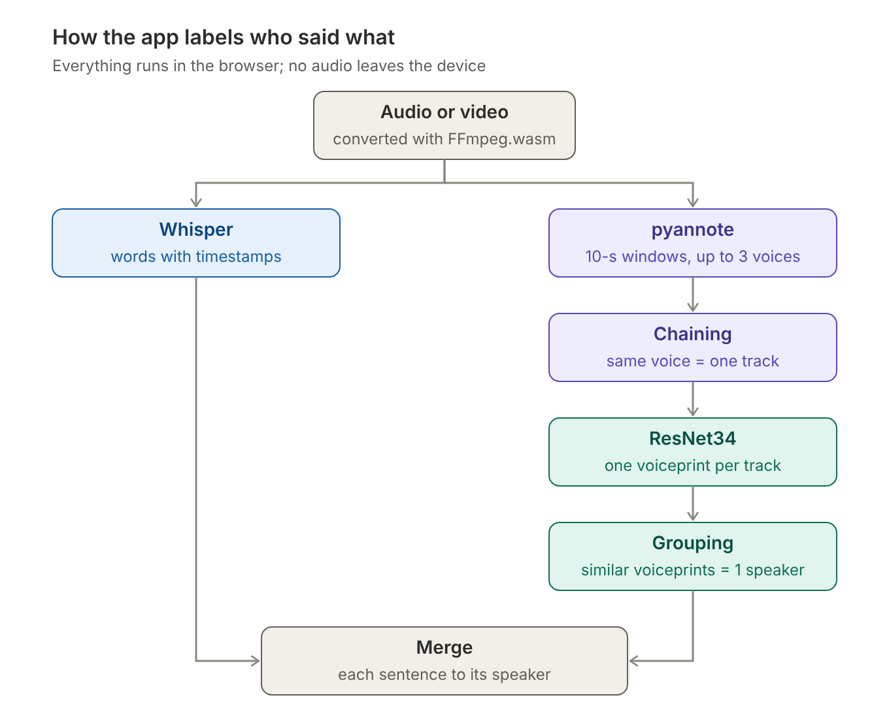

**1. pyannote hears 10 seconds at a time.** That is the length it was trained on. It tells apart at most 3 voices per window, so a fourth gets lumped in with someone else. How often that matters depends on the recording:

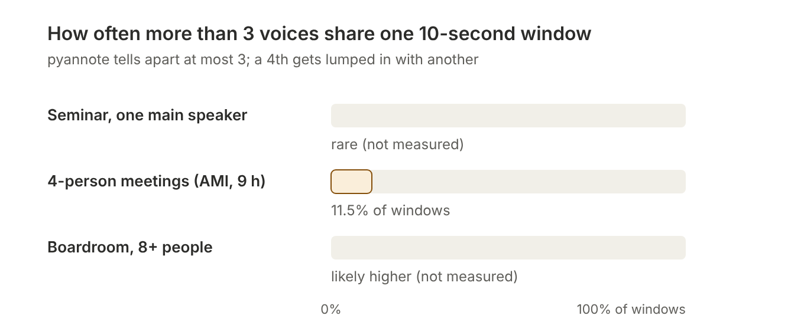

**2. Overlapping windows link the same person.** pyannote restarts its numbering in every window. A voice talking during the 5 seconds two windows share is the same voice, so each person becomes one track:

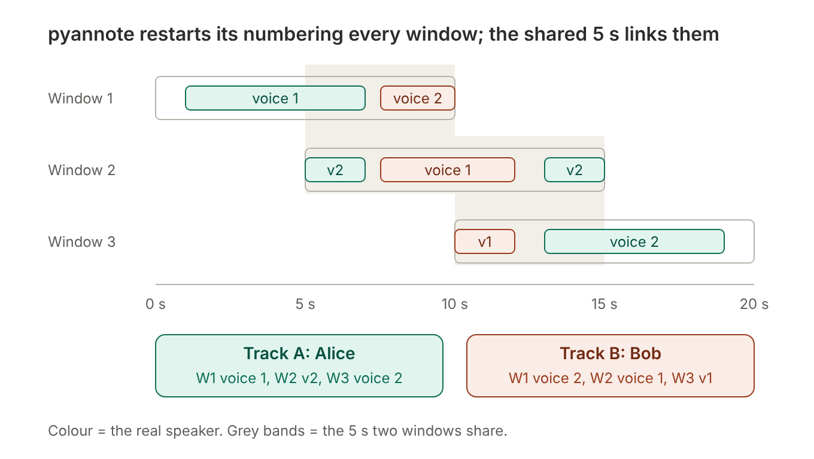

**3. ResNet34 for voiceprints, not WavLM.** Same pipeline, only the voiceprint model swapped, speaker count given so no threshold is involved:

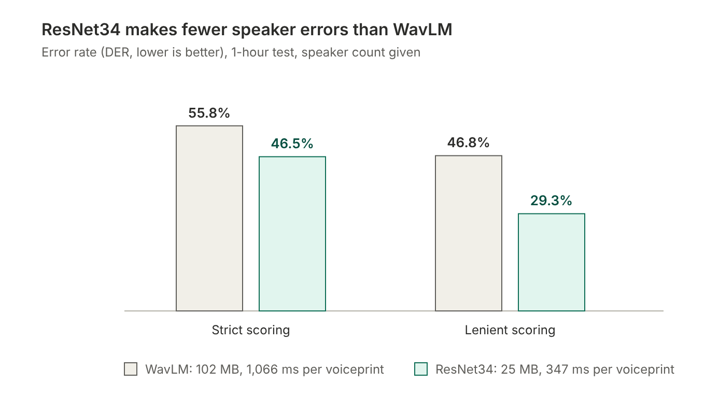

**4. The cost: an fbank front end.** WavLM reads raw audio; ResNet34 reads fbank features, which its ONNX file doesn't include. `src/workers/kaldi-fbank.ts` computes them and matches the reference Kaldi implementation to within 0.00004:

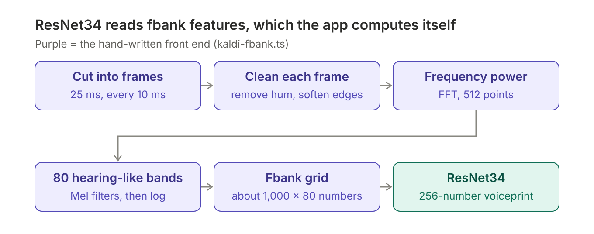

**5. Models come from Hugging Face at build time.** Builds start from a clean copy each time, so they re-download every model (about 0.7 GB); Hugging Face doesn't meter that, B2 does. Visitors load models from the site itself:

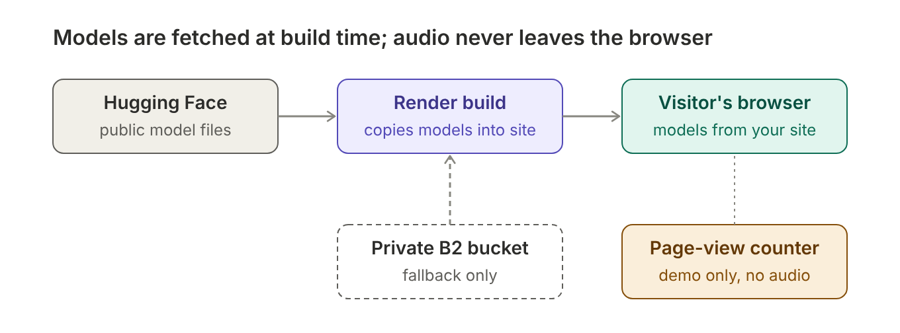

## Measuring accuracy

`npm run eval` runs the exact speaker code the app runs (`src/workers/speaker-labelling.ts`) on recordings with human speaker labels, and reports the diarization error rate (DER): the share of speech time with the wrong speaker, a missed speaker or a false alarm. Lower is better.

```powershell
npm run eval:data                    # downloads 4 AMI test meetings (about 100 minutes); -All for all 16
npm run eval                         # ResNet34, Auto and known speaker count
npm run eval -- --voice wavlm        # WavLM, for comparison (needs Xenova/wavlm-base-plus-sv)
```

The scoring matches pyannote's official tool (`pyannote.metrics`) to within 0.1%. Results above are from AMI meeting excerpts arranged into a 1-hour recording; the full AMI meetings from `npm run eval:data` are the stronger test. WavLM ran in 8-bit precision and ResNet34 in full precision.

## Common Issues & Fixes

**Models not reading correctly / fetched from huggingface.co.** The folder structure must match the model ID exactly, and a single missing JSON file gives the same error. Run the download script with `-CheckOnly` to see what is missing.

**Network tab shows `cdn.jsdelivr.net` or `unpkg.com`.** The files in `public/ort` or `public/ffmpeg` are missing from `dist`. They only reach `dist` when you run `npm run build`.

**`Unexpected token '<'` when loading FFmpeg or ONNX Runtime.** Same cause: `serve -s dist` answers a missing file with `index.html`. Rebuild after copying the files into `public/`.

**`SSL certificate problem: self-signed certificate`.** Common behind corporate proxies. Use `git -c http.sslVerify=false clone …` for that one command.

## Acknowledgements and licenses

This project is released under the [MIT License](LICENSE). It builds on the following work, which keeps its own license:

| Component | Credit | License |
|---|---|---|
| Whisper speech recognition models | [OpenAI](https://github.com/openai/whisper), *Robust Speech Recognition via Large-Scale Weak Supervision* ([arXiv:2212.04356](https://arxiv.org/abs/2212.04356)) | Apache-2.0 (per the [Hugging Face model card](https://huggingface.co/openai/whisper-tiny.en)) |
| Whisper ONNX weights | [Xenova](https://huggingface.co/Xenova) (Joshua Lochner): [whisper-tiny.en](https://huggingface.co/Xenova/whisper-tiny.en), [whisper-base.en](https://huggingface.co/Xenova/whisper-base.en), [whisper-base](https://huggingface.co/Xenova/whisper-base); [onnx-community/whisper-base_timestamped](https://huggingface.co/onnx-community/whisper-base_timestamped) | Apache-2.0 |
| Speaker voiceprint model | WeSpeaker ResNet34 from [pyannote/speaker-diarization-community-1](https://huggingface.co/pyannote/speaker-diarization-community-1) ([WeSpeaker](https://github.com/wenet-e2e/wespeaker), [arXiv:2210.17016](https://arxiv.org/abs/2210.17016)); ONNX export [FredrikKarlssonSpeech/pyannote-speaker-diarization-onnx](https://huggingface.co/FredrikKarlssonSpeech/pyannote-speaker-diarization-onnx) | CC BY 4.0 |
| Speaker segmentation model | [pyannote/segmentation-3.0](https://huggingface.co/pyannote/segmentation-3.0) by the [pyannote](https://github.com/pyannote/pyannote-audio) team; ONNX conversion [onnx-community/pyannote-segmentation-3.0](https://huggingface.co/onnx-community/pyannote-segmentation-3.0) | MIT |
| Starting point for the app | [xenova/whisper-web](https://github.com/xenova/whisper-web/tree/experimental-webgpu) (`experimental-webgpu` branch) | MIT |
| Starting point for speaker mode | [Xenova/whisper-speaker-diarization](https://huggingface.co/spaces/Xenova/whisper-speaker-diarization) (Hugging Face Space) | not stated |
| In-browser inference | [Transformers.js](https://github.com/huggingface/transformers.js) by Hugging Face | Apache-2.0 |
| ONNX runtime | [ONNX Runtime Web](https://github.com/microsoft/onnxruntime) by Microsoft (copy in `public/ort`) | MIT |
| Audio extraction | [ffmpeg.wasm](https://github.com/ffmpegwasm/ffmpeg.wasm): `@ffmpeg/ffmpeg`, `@ffmpeg/util` | MIT |
| FFmpeg core | `@ffmpeg/core` (copy in `public/ffmpeg`) | GPL-2.0-or-later |

The model files under `public/models/` are redistributed unmodified under their own licenses. See [`public/models/NOTICE.md`](public/models/NOTICE.md) and [`public/models/LICENSE`](public/models/LICENSE). The FFmpeg core files are covered by [`public/ffmpeg/NOTICE.md`](public/ffmpeg/NOTICE.md).

## Technology Stack

- React 18 with TypeScript
- Vite 7 for build tooling
- Tailwind CSS + shadcn/ui for styling
- @huggingface/transformers for AI model inference
- @ffmpeg/ffmpeg for audio extraction
- WebGPU acceleration (with WASM fallback)

<p>— <b>Join me on 📝 <b>Medium</b> at <a href='https://medium.com/@geek-cc' target='_blank'>~ ξ(🎀˶❛◡❛) @geek-cc</a></b></p>

---

#### 🌮 Please buy me a <a href='https://www.buymeacoffee.com/geekcc' target='_blank'>Taco</a>! 😋
